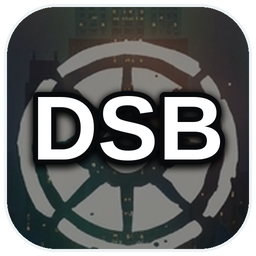

<p align="center">
  
</p>

<h1 align="center">DSB</h1>
<p align="center"><strong>Deadlock Server Blocker</strong></p>

A lightweight desktop app for **Linux** and **Windows 10/11** that lets you pick which **Deadlock** server regions you want to match into by blocking unwanted Valve relay IPs in your system firewall.

> [!NOTE]
> **Based on [`FN-FAL113/server-picker-x`](https://github.com/FN-FAL113/server-picker-x)** (GPL-3.0) — reimagined specifically for Deadlock with a minimal black tile UI.
> **Built with Agentic AI:** Created with the help of **Antigravity** (Google DeepMind).

---

## Is this a cheat or hack?

**No.** DSB is strictly a firewall manager:
- **Zero game interaction:** It never injects into Deadlock, never reads/modifies game memory, and never touches Steam or game files.
- **Standard OS firewall rules only:** It pulls Valve's public Deadlock relay IP list (`GetSDRConfig`, `appid=1422450`) and blocks the regions you click using your OS firewall (`iptables` on Linux, Windows Defender Firewall on Windows). Matchmaking simply skips unreachable relays and places you on your allowed regions.
- **No background process while playing:** Once you apply your blocks, you can close DSB before launching Deadlock.
- **Why it asks for `sudo` / Administrator:** Modifying OS firewall rules requires elevated permissions. DSB only touches its own isolated `DSB_BLOCK` rules — it never flushes UFW or resets your other Windows Firewall rules.

---

## Features

- **Interactive tile UI:** Popped-out white-halo tiles are **ON**; dimmed recessed tiles with red `BLOCKED` are blocked.
- **Live telemetry:** Real-time ping (`ms`) and packet loss (`%`) per region via UDP SDR probing with ICMP fallback (works cleanly through VPN/TUN proxies like NekoRay/sing-box).
- **Fast filtering:** Region dropdown (`Europe (EU)`, `North America`, `South America`, `Asia`, `Middle East`, `Oceania`, `Africa`, `All Regions`), search, Cluster toggle, Name/Ping sort, and saved Presets.
- **Safe one-click reset:** Removes only DSB's firewall rules cleanly.

---

## Installation

### Linux (Arch / CachyOS, Ubuntu / Debian, Fedora)
Install dependencies:
- **Arch / CachyOS:** `sudo pacman -S python-gobject gtk4 webkitgtk-6.0 iptables util-linux iputils kdialog`
- **Ubuntu / Debian:** `sudo apt install python3-gi gir1.2-gtk-4.0 gir1.2-webkit-6.0 iptables util-linux iputils-ping zenity`
- **Fedora:** `sudo dnf install python3-gobject gtk4 webkitgtk6.0 iptables util-linux iputils kdialog`

Install & add to your application menu:
```bash
git clone https://github.com/Zyd93/deadlock-server-blocker-DSB.git
cd deadlock-server-blocker-DSB
./install.sh
```
*(Run `./uninstall.sh` to remove launchers and desktop entries.)*

### Windows 10 / 11
- **Prebuilt `.exe`:** Download `DeadlockServerBlocker-DSB.exe` from [**Releases**](https://github.com/Zyd93/deadlock-server-blocker-DSB/releases) (or [**Actions**](https://github.com/Zyd93/deadlock-server-blocker-DSB/actions) artifacts) and run it (accept the UAC prompt).
- **From source** *(requires Python 3.10+)*:
  ```powershell
  git clone https://github.com/Zyd93/deadlock-server-blocker-DSB.git
  cd deadlock-server-blocker-DSB
  .\scripts\run_windows.bat
  ```
- **Build `.exe` locally:** `.\scripts\build_windows.ps1`

---

## Troubleshooting

- **Red "sudo expired" warning / "blocked status unknown":** DSB can't read the firewall because its `sudo` session ended. Close and reopen DSB to re-authenticate. While this warning is shown, server tiles may look unblocked even if rules are still active, and saving presets is disabled.
- **Blocks are gone after a reboot:** This is expected. DSB's rules are not saved to disk, so reopen DSB and re-apply your preset after restarting.
- **Errors about a missing `iptables` on Debian / Ubuntu:** Install the `iptables` package. DSB looks in `/usr/sbin` and `/sbin` as well as your `PATH`.
- **firewalld users:** Reloading firewalld can drop DSB's rules. Re-apply your preset afterwards.
- **IPv6:** DSB only blocks IPv4 relay addresses.
- **No ping shown for a region:** The relay didn't answer DSB's UDP probe or ICMP ping. Behind a VPN / TUN proxy, DSB deliberately ignores fake sub-1 ms replies that the proxy answers locally.
- **Remove everything DSB added:** Use **Reset Firewall** in the app. It deletes only DSB's own `DSB_BLOCK` chain and never touches UFW or other rules.

---

## Tests

```bash
python3 -m unittest discover -s tests -v
```

---

## Contributors

- **[@Zyd93](https://github.com/Zyd93)** — Project Creator & Maintainer
- **Antigravity (Google DeepMind)** — Agentic AI Contributor

## License

GNU General Public License v3.0 ([LICENSE](LICENSE)), matching upstream [`FN-FAL113/server-picker-x`](https://github.com/FN-FAL113/server-picker-x).
*Deadlock and Steam Datagram Relay are property of Valve Corporation. Unofficial community tool.*
